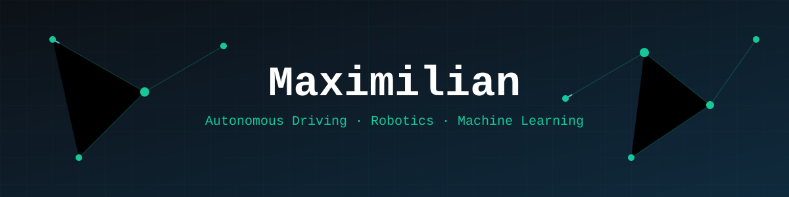
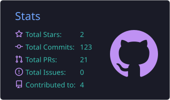
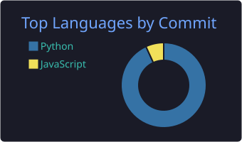
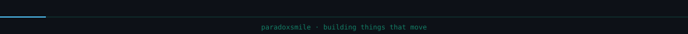

## 👋 About

- 🎓 Dual student, **B.Sc. Data Science & AI** @ DHBW Ravensburg (focus: AI & Intelligence Engineering)
- 🏎️ Autonomous driving team @ **Global Formula Racing**: Driverless stack in ROS (C++/Python)
- 🚗 Practical phases at a Mercedes-Benz subsidiary
- 🚀 Long-term: building a deep-tech startup

## 🔭 Currently building

- **[Flybrain](https://github.com/paradoxsmile/flybrain)**: typing rare neurons in an unlabeled connectome from wiring alone, with a transferred GNN plus graph matching (FlyWire → BANC, MCNS) · *done, paper + code*
- **[Replico](https://github.com/paradoxsmile/Replico)**: painting robot that turns an image into real brush strokes, with Klipper G-code for a DIY vertical CNC easel · *open source*
- **EEG headband + CLAS**: custom EEG headband with closed-loop auditory stimulation for sleep · *private, early stage*
- **[Arkytas](https://github.com/Arkytas)**: small physical-AI lab in Ravensburg, co-founded with two partners · robots, models, agents · [Hugging Face](https://huggingface.co/Arkytas)

### 🏎️ Global Formula Racing · Driverless

- **Controller benchmarking**: closed-loop simulation comparison of longitudinal controllers (curvature-based lookahead vs. turning-radius baseline), including curvature-estimation variants and dynamic braking
- **LiDAR ground segmentation**: benchmarking and implementing Himmelsbach-style line-fit ground removal, a significant improvement over the RANSAC baseline

## 🛠️ Tech Stack

| | |
|---|---|
| **Languages** |  |
| **ML & Data** |  |
| **Robotics & Systems** |  |

Also: PyTorch Geometric · ESP32 · GRBL · LiDAR perception

## 📊 GitHub Stats

  
  

## 📫 Connect

